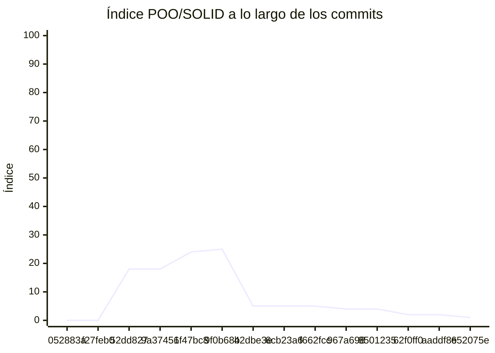

<!-- evaluacion:inicio -->
# Evaluación — organizacion-1-1/GravityQuest-Proyecto-Final

> Documento **generado automáticamente** por la cátedra de Programación II (RepoSense + análisis de calidad POO/SOLID). **No editar a mano**: se regenera en cada evaluación.
> Rama evaluada: `main`. Análisis **heurístico** (regex + métricas): es una criba para orientar la revisión, **no una nota**.
> Generado: 2026-10-17.

## 1. Veredicto

| Aspecto | Resultado |
|---|---|
| Índice de calidad POO/SOLID | **1/100** |
| Código (LOC) | 6,182 |
| Archivos de código | 33 |
| Clases (bien usadas) | 67 (3 OK) |
| Código dentro de clases (%POO) | 75% |
| Funciones fuera de clases | 7 |
| Duplicación | 86.7% |
| Señales S/O/L/I/D | 31/2/0/0/35 |
| Tope duro aplicado | `DUP>=50%` → índice ≤ 15 |

> Este informe **describe** lo que el análisis midió con los criterios ya establecidos de la materia. No es una nota.

### Semáforo de aprobación

Criterios de `CRITERIOS-CALIDAD.md`. **Aprobar** se juega con el perfil `estandar`; **destacar**, con el `exigente` (meta de excelencia).

| Semáforo | Resultado |
|---|---|
| Aprobar (`estandar`) | **no cumple** — 0/4 |
| Destacar (`exigente`) | **no cumple** — 0/5 |

**Criterios para aprobar**

| Criterio | Requisito | Tu resultado | Cumple |
|---|---|---|---|
| Código dentro de clases (%POO) | ≥ 85% | 75% | no |
| Duplicación | ≤ 10% | 86.0% | no |
| Funciones fuera de clases | ≤ 1 | 7 | no |
| Señales POO/SOLID críticas | ninguna | Clase demasiado grande (SRP), Baja cohesión (LCOM), Complejidad alta, Acoplamiento alto (CBO), Switch sobre tipos (OCP) | no |

**Criterios para destacar**

| Criterio | Requisito | Tu resultado | Cumple |
|---|---|---|---|
| Código dentro de clases (%POO) | ≥ 95% | 75% | no |
| Duplicación | ≤ 5% | 86.7% | no |
| Funciones fuera de clases | ≤ 0 | 7 | no |
| Señales POO/SOLID críticas | ninguna | Clase demasiado grande (SRP), Baja cohesión (LCOM), Complejidad alta, Acoplamiento alto (CBO), Switch sobre tipos (OCP) | no |
| Índice de calidad POO/SOLID | ≥ 60 | 1/100 | no |

## 2. Autoría (RepoSense)

| Autor | Commits | Código (LOC) | Tests (LOC) | Docs (LOC) | Días activos | % del código |
|---|---:|---:|---:|---:|---:|---:|
| colombati-creator | 14 | 6,591 | 1,007 | 2 | 9 | 100% |

> _El LOC de autoría lo calcula RepoSense sobre el historial y puede diferir del LOC de código del análisis de calidad (que mira solo el estado de `main`)._

## 3. Aspectos evaluados

Cada aspecto indica **qué mide**, **por qué importa** y **tu resultado**. Cuando el análisis reportó una señal, se agregan preguntas para **investigar la causa** (no hay recetas: entender el porqué es parte de la evaluación).

### 1. Índice de calidad POO/SOLID (indice)

- **Qué mide:** Un resumen numérico (0-100) que combina la riqueza de clases bien usadas con la penalización por señales POO/SOLID y duplicación, y luego aplica topes duros.
- **Por qué importa:** Ordena y prioriza la revisión: un índice bajo indica varias señales que conviene mirar juntas.
- **Tu resultado:** índice **1/100**

### 2. Duplicación (DRY) (duplicacion) — con señales

- **Qué mide:** Porcentaje de bloques de código repetidos (similitud) en el repositorio.
- **Por qué importa:** Cada copia se mantiene por separado: un arreglo hay que repetirlo y los defectos se multiplican.
- **Tu resultado:** **86.7%** de duplicación
- **Para investigar la causa:**
    - ¿El trabajo se repartió por pantallas o archivos y se integró copiando y pegando bloques?
    - ¿Qué zonas del sistema cambiaron juntas más de una vez (señal de lógica compartida)?
    - ¿Hubo un lugar común acordado para la lógica repetida antes de empezar, o cada integrante resolvió lo suyo?

### 3. Adopción de POO (% de código en clases) (poo) — sin señales

- **Qué mide:** Qué porción del código vive dentro de clases (no de funciones sueltas).
- **Por qué importa:** El diseño orientado a objetos es el eje de la materia: el comportamiento debería vivir como método de una clase.
- **Tu resultado:** **75.4%** del código dentro de clases

### 4. Funciones fuera de clases (sueltas) — con señales

- **Qué mide:** Funciones de nivel de módulo que no pertenecen a ninguna clase (en esta materia el comportamiento debe ser método de una clase).
- **Por qué importa:** Son la forma más directa de código procedural en un proyecto que debería ser orientado a objetos.
- **Tu resultado:** **7** función(es) fuera de clases
- **Para investigar la causa:**
    - ¿Esa función se dejó suelta por urgencia o por desconocer dónde ubicarla?
    - ¿Qué clase debería ser responsable de ese comportamiento?
    - ¿Había una convención sobre dónde poner cada cosa?

### 5. Clase demasiado grande (SRP) (god) — con señales

- **Qué mide:** Clases con muchas líneas, métodos o campos a la vez.
- **Por qué importa:** Una clase que hace de todo cambia por muchos motivos y cuesta entenderla y probarla.
- **Tu resultado:** **25** clase(s) demasiado grande(s)
- **Para investigar la causa:**
    - ¿La clase creció por acumulación de responsabilidades?
    - ¿Qué partes de la clase se usan siempre juntas y cuáles no?
    - ¿Se podría describir su responsabilidad en una sola frase?

### 6. Baja cohesión (LCOM) (cohesion) — con señales

- **Qué mide:** Métodos y campos de una clase que casi no se relacionan entre sí.
- **Por qué importa:** Una unidad que cambia por motivos distintos y comparte poca información suele esconder más de una responsabilidad.
- **Tu resultado:** **4** clase(s) con baja cohesión
- **Para investigar la causa:**
    - ¿Qué métodos de la clase no comparten estado con el resto?
    - ¿Cambian por motivos distintos según la tarea?
    - ¿Se pensó su responsabilidad antes de escribirla, o se fue agregando?

### 7. Complejidad alta (complejidad) — con señales

- **Qué mide:** Complejidad ciclomática: cantidad de caminos posibles dentro de un método o función (condicionales, bucles, casos).
- **Por qué importa:** Muchos caminos = difícil de seguir y de probar; suelen esconderse casos sin cubrir.
- **Tu resultado:** **3** método(s)/función(es) con complejidad alta
- **Para investigar la causa:**
    - ¿Se agregaron condiciones a medida que aparecían casos nuevos?
    - ¿Se probaron todos los caminos o solo el caso principal?
    - ¿Hay reglas de negocio mezcladas con detalles técnicos?

### 8. Métodos/funciones largos o con muchos parámetros (tamano) — con señales

- **Qué mide:** Tamaño de los métodos/funciones y cantidad de parámetros.
- **Por qué importa:** Una función que hace varias cosas cuesta leerla, nombrarla y reutilizarla.
- **Tu resultado:** **13** método(s)/función(es) largos o con muchos parámetros
- **Para investigar la causa:**
    - ¿La función creció por acumulación de pasos?
    - ¿Agrupa operaciones que podrían describirse por separado?
    - ¿Los parámetros representan una misma idea (un objeto) o cosas sueltas?

### 9. Acoplamiento alto (CBO) (acoplamiento) — con señales

- **Qué mide:** Cuánto depende una clase de otros tipos del proyecto.
- **Por qué importa:** Piezas muy enlazadas hacen que un cambio se propague y que sea difícil reemplazar partes.
- **Tu resultado:** **40** clase(s) muy acoplada(s)
- **Para investigar la causa:**
    - ¿La clase conoce detalles internos de muchas otras?
    - ¿Se puede cambiar una parte sin tocar las demás?
    - ¿Los colaboradores llegan como parámetros o se crean por dentro?

### 10. Herencia profunda (DIT) (herencia) — con señales

- **Qué mide:** Profundidad de la cadena de herencia de una clase.
- **Por qué importa:** Jerarquías muy profundas vuelven difícil saber de dónde viene cada comportamiento.
- **Tu resultado:** **2** clase(s) con herencia profunda
- **Para investigar la causa:**
    - ¿La jerarquía creció para reutilizar código o para modelar una relación real 'es-un'?
    - ¿Qué comportamiento cambia entre niveles de la jerarquía?
    - ¿Se evaluó la composición como alternativa?

### 11. Switch sobre tipos (OCP) (ocp) — con señales

- **Qué mide:** Chequeos repetidos de tipo (`instanceof`/`is`/`typeof`) que equivalen a un switch sobre el tipo.
- **Por qué importa:** Cada tipo nuevo obliga a tocar varios lugares, en vez de extender con una implementación nueva.
- **Tu resultado:** **2** clase(s) con switch sobre tipos
- **Para investigar la causa:**
    - ¿Qué operación se resuelve preguntando el tipo?
    - ¿Qué se toca cada vez que aparece un tipo o caso nuevo?
    - ¿El comportamiento podría vivir en la propia jerarquía de tipos?

### 12. Interfaz con demasiados métodos (ISP) (isp) — sin señales

- **Qué mide:** Interfaces o clases abstractas con muchos métodos declarados.
- **Por qué importa:** Obliga a implementar operaciones que no se usan y acopla a los clientes a métodos que no necesitan.
- **Tu resultado:** **0** interfaz(es) con demasiados métodos

### 13. Override vacío o 'no implementado' (LSP) (lsp) — sin señales

- **Qué mide:** Métodos sobrescritos que quedan vacíos o lanzan 'no implementado'.
- **Por qué importa:** Suele indicar que la jerarquía no representa bien el problema y rompe la sustitución entre clases.
- **Tu resultado:** **0** override(s) vacío(s) o 'no implementado'

### 14. Dependencia de concretos y falta de abstracciones (DIP) (dip) — con señales

- **Qué mide:** Instanciación directa de clases concretas y ausencia de interfaces o clases abstractas pese al acoplamiento.
- **Por qué importa:** Depender de implementaciones concretas dificulta cambiar o probar una parte sin arrastrar las demás.
- **Tu resultado:** **35** dependencia(s) de concretos sin abstracciones
- **Para investigar la causa:**
    - ¿La clase crea por dentro a sus colaboradores en vez de recibirlos?
    - ¿Hay puntos de variación que convendría expresar como abstracción?
    - ¿Cómo se probaría esa clase cambiando una implementación?

### 15. Clase sin métodos (solo datos) (data) — con señales

- **Qué mide:** Clases que solo acumulan campos y no tienen comportamiento.
- **Por qué importa:** Separar datos de comportamiento reparte por el proyecto la lógica que debería estar cerca de esos datos.
- **Tu resultado:** **5** clase(s) sin métodos (solo datos)
- **Para investigar la causa:**
    - ¿Dónde vive el comportamiento que opera sobre esos datos?
    - ¿La clase representa un concepto del dominio o un contenedor técnico?
    - ¿Se evita la lógica de negocio dentro de la clase por comodidad?

### 16. Campos públicos (encapsulación) (encapsulacion) — con señales

- **Qué mide:** Clases que exponen campos sin control de acceso.
- **Por qué importa:** Expone el estado interno y hace que cualquier cambio dependa de quién lo modifica desde afuera.
- **Tu resultado:** **33** clase(s) con campos públicos
- **Para investigar la causa:**
    - ¿Se accede al campo desde otras clases para evitar un método?
    - ¿Qué reglas deberían respetarse al modificar ese estado?
    - ¿Los campos públicos se usan más como configuración que como estado?

### 17. Clase solo con métodos estáticos (utilitaria) (static) — sin señales

- **Qué mide:** Clases donde todos los métodos son estáticos.
- **Por qué importa:** Es comportamiento procedural disfrazado de clase: no se instancia ni participa del modelo de objetos.
- **Tu resultado:** **0** clase(s) solo con métodos estáticos

## 4. Anexo: dónde mirar

Archivos donde el análisis encontró cada señal (sin número de línea, a propósito):

**Clase demasiado grande (SRP) (god)** — 23 archivo(s):
- `app/src/main/kotlin/gravityquest/NavegadorEscenas.kt`
- `app/src/main/kotlin/gravityquest/VistaJuego.kt`
- `app/src/main/kotlin/gravityquest/VistaMenu.kt`
- `app/src/main/kotlin/gravityquest/models/GeneradorProblemas.kt`
- `app/src/main/kotlin/gravityquest/models/Problema.kt`
- `app/src/main/kotlin/org/example/Juego/Formulas.kt`
- `app/src/main/kotlin/org/example/Juego/Main.kt`
- `app/src/test/kotlin/gravityquest/CalculadoraFisicaTest.kt`
- `app/src/test/kotlin/gravityquest/MainTest.kt`
- `app/src/test/kotlin/gravityquest/ModelosTest.kt`
- `app/src/test/kotlin/gravityquest/NavegacionTest.kt`
- `src/NavegadorEscenas.kt`
- `src/VistaJuego.kt`
- `src/VistaMenu.kt`
- `src/models/GeneradorProblemas.kt`
- `src/models/Problema.kt`
- `src_(codigo)/Formulas.kt`
- `src_(codigo)/NavegadorEscenas.kt`
- `src_(codigo)/VistaJuego.kt`
- `src_(codigo)/VistaMenu.kt`
- `src_(codigo)/main.kt`
- `src_(codigo)/models/GeneradorProblemas.kt`
- `src_(codigo)/models/Problema.kt`

**Baja cohesión (LCOM) (cohesion)** — 4 archivo(s):
- `app/src/main/kotlin/gravityquest/NavegadorEscenas.kt`
- `app/src/test/kotlin/gravityquest/NavegacionTest.kt`
- `src/NavegadorEscenas.kt`
- `src_(codigo)/NavegadorEscenas.kt`

**Complejidad alta (complejidad)** — 3 archivo(s):
- `app/src/main/kotlin/org/example/Juego/Main.kt`
- `app/src/test/kotlin/gravityquest/NavegacionTest.kt`
- `src_(codigo)/main.kt`

**Métodos/funciones largos o con muchos parámetros (tamano)** — 7 archivo(s):
- `app/src/main/kotlin/gravityquest/models/GeneradorProblemas.kt`
- `app/src/main/kotlin/org/example/Juego/Formulas.kt`
- `app/src/main/kotlin/org/example/Juego/Main.kt`
- `src/models/GeneradorProblemas.kt`
- `src_(codigo)/Formulas.kt`
- `src_(codigo)/main.kt`
- `src_(codigo)/models/GeneradorProblemas.kt`

**Acoplamiento alto (CBO) (acoplamiento)** — 26 archivo(s):
- `app/src/main/kotlin/gravityquest/NavegadorEscenas.kt`
- `app/src/main/kotlin/gravityquest/VistaJuego.kt`
- `app/src/main/kotlin/gravityquest/VistaMenu.kt`
- `app/src/main/kotlin/gravityquest/models/Dificultad.kt`
- `app/src/main/kotlin/gravityquest/models/GeneradorProblemas.kt`
- `app/src/main/kotlin/gravityquest/models/Problema.kt`
- `app/src/main/kotlin/org/example/Juego/Formulas.kt`
- `app/src/main/kotlin/org/example/Juego/Main.kt`
- `app/src/test/kotlin/gravityquest/CalculadoraFisicaTest.kt`
- `app/src/test/kotlin/gravityquest/MainTest.kt`
- `app/src/test/kotlin/gravityquest/ModelosTest.kt`
- `app/src/test/kotlin/gravityquest/NavegacionTest.kt`
- `src/NavegadorEscenas.kt`
- `src/VistaJuego.kt`
- `src/VistaMenu.kt`
- `src/models/Dificultad.kt`
- `src/models/GeneradorProblemas.kt`
- `src/models/Problema.kt`
- `src_(codigo)/Formulas.kt`
- `src_(codigo)/NavegadorEscenas.kt`
- `src_(codigo)/VistaJuego.kt`
- `src_(codigo)/VistaMenu.kt`
- `src_(codigo)/main.kt`
- `src_(codigo)/models/Dificultad.kt`
- `src_(codigo)/models/GeneradorProblemas.kt`
- `src_(codigo)/models/Problema.kt`

**Herencia profunda (DIT) (herencia)** — 2 archivo(s):
- `app/src/main/kotlin/org/example/Juego/Main.kt`
- `src_(codigo)/main.kt`

**Switch sobre tipos (OCP) (ocp)** — 2 archivo(s):
- `app/src/test/kotlin/gravityquest/MainTest.kt`
- `app/src/test/kotlin/gravityquest/NavegacionTest.kt`

**Dependencia de concretos y falta de abstracciones (DIP) (dip)** — 26 archivo(s):
- `app/src/main/kotlin/gravityquest/NavegadorEscenas.kt`
- `app/src/main/kotlin/gravityquest/VistaJuego.kt`
- `app/src/main/kotlin/gravityquest/VistaMenu.kt`
- `app/src/main/kotlin/gravityquest/models/Dificultad.kt`
- `app/src/main/kotlin/gravityquest/models/GeneradorProblemas.kt`
- `app/src/main/kotlin/gravityquest/models/Problema.kt`
- `app/src/main/kotlin/org/example/Juego/Formulas.kt`
- `app/src/main/kotlin/org/example/Juego/Main.kt`
- `app/src/test/kotlin/gravityquest/CalculadoraFisicaTest.kt`
- `app/src/test/kotlin/gravityquest/MainTest.kt`
- `app/src/test/kotlin/gravityquest/ModelosTest.kt`
- `app/src/test/kotlin/gravityquest/NavegacionTest.kt`
- `src/NavegadorEscenas.kt`
- `src/VistaJuego.kt`
- `src/VistaMenu.kt`
- `src/models/Dificultad.kt`
- `src/models/GeneradorProblemas.kt`
- `src/models/Problema.kt`
- `src_(codigo)/Formulas.kt`
- `src_(codigo)/NavegadorEscenas.kt`
- `src_(codigo)/VistaJuego.kt`
- `src_(codigo)/VistaMenu.kt`
- `src_(codigo)/main.kt`
- `src_(codigo)/models/Dificultad.kt`
- `src_(codigo)/models/GeneradorProblemas.kt`
- `src_(codigo)/models/Problema.kt`

**Clase sin métodos (solo datos) (data)** — 5 archivo(s):
- `app/src/main/kotlin/gravityquest/models/Problema.kt`
- `app/src/main/kotlin/org/example/Juego/Main.kt`
- `src/models/Problema.kt`
- `src_(codigo)/main.kt`
- `src_(codigo)/models/Problema.kt`

**Campos públicos (encapsulación) (encapsulacion)** — 15 archivo(s):
- `app/src/main/kotlin/gravityquest/NavegadorEscenas.kt`
- `app/src/main/kotlin/gravityquest/VistaJuego.kt`
- `app/src/main/kotlin/gravityquest/VistaMenu.kt`
- `app/src/main/kotlin/gravityquest/models/Problema.kt`
- `app/src/main/kotlin/org/example/Juego/Main.kt`
- `app/src/test/kotlin/gravityquest/NavegacionTest.kt`
- `src/NavegadorEscenas.kt`
- `src/VistaJuego.kt`
- `src/VistaMenu.kt`
- `src/models/Problema.kt`
- `src_(codigo)/NavegadorEscenas.kt`
- `src_(codigo)/VistaJuego.kt`
- `src_(codigo)/VistaMenu.kt`
- `src_(codigo)/main.kt`
- `src_(codigo)/models/Problema.kt`

## 5. Evolución por commit

Métricas calculadas sobre el estado de `main` en **cada commit** (14 commits con trabajo), del primero al último. La calidad usa el perfil `exigente`; el aporte de código lo mide RepoSense. El índice puede **bajar** al crecer el proyecto: se acumulan señales.

| # | Fecha | Commit | Autor | LOC | Índice | %POO | Duplic. | Sueltas |
|---|---|---|---|---:|---:|---:|---:|---:|
| 1 | 2026-08-21 | `052883a` | ciro | 0 | 0 | 0% | 0.0% | 0 |
| 2 | 2026-08-24 | `f27feb0` | dqmdz-etec | 0 | 0 | 0% | 0.0% | 0 |
| 3 | 2026-08-28 | `52dd827` | ciro | 76 | 18 | 16% | 12.1% | 1 |
| 4 | 2026-08-28 | `9a37451` | ciro | 76 | 18 | 16% | 12.1% | 1 |
| 5 | 2026-09-04 | `6f47bc8` | ciro | 135 | 24 | 22% | 6.5% | 2 |
| 6 | 2026-09-07 | `9f0b68b` | ciro | 159 | 25 | 26% | 5.6% | 2 |
| 7 | 2026-10-02 | `42dbe3e` | ciro | 326 | 5 | 32% | 80.5% | 3 |
| 8 | 2026-10-05 | `6cb23a6` | ciro | 467 | 5 | 63% | 69.6% | 3 |
| 9 | 2026-10-05 | `f662fcc` | ciro | 523 | 5 | 66% | 68.2% | 3 |
| 10 | 2026-10-05 | `967a698` | ciro | 1,336 | 4 | 78% | 85.3% | 3 |
| 11 | 2026-10-09 | `8501235` | ciro | 1,640 | 4 | 76% | 85.0% | 1 |
| 12 | 2026-10-09 | `62f0ff0` | ciro | 3,354 | 2 | 78% | 86.9% | 3 |
| 13 | 2026-10-09 | `aaddf8e` | ciro | 4,142 | 2 | 73% | 85.2% | 5 |
| 14 | 2026-10-16 | `652075e` | ciro | 6,182 | 1 | 75% | 86.7% | 7 |

---
_Informe generado por la cátedra. Los criterios y umbrales de medición corresponden al perfil `exigente` de `calidad.py`; el semáforo de aprobación, a `CRITERIOS-CALIDAD.md` (ver `README.md`). Ante dudas, revisá el archivo señalado._
<!-- evaluacion:fin -->
